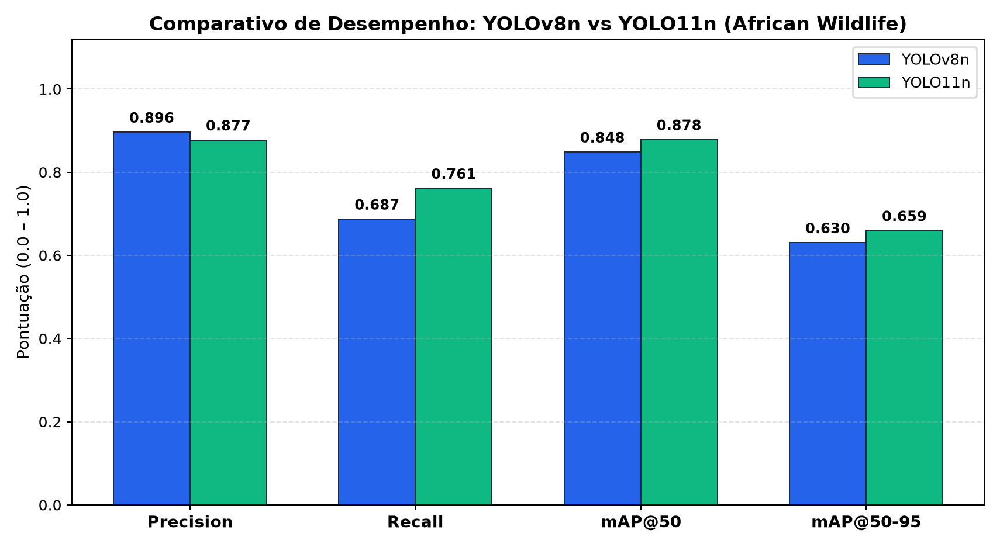
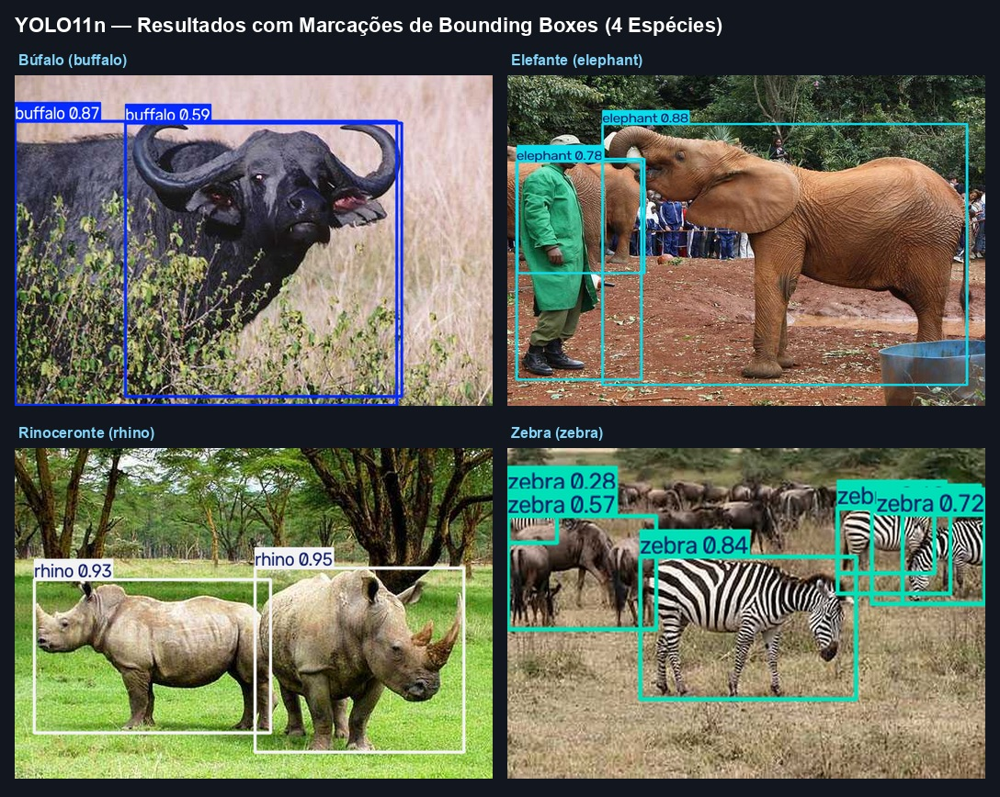
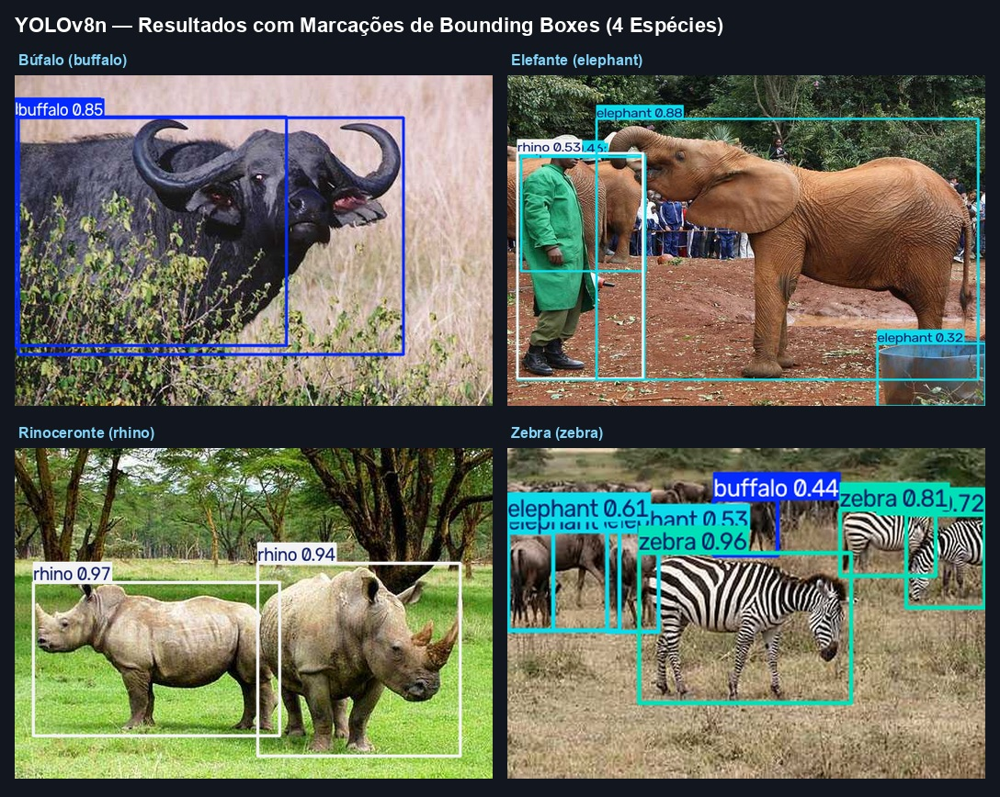
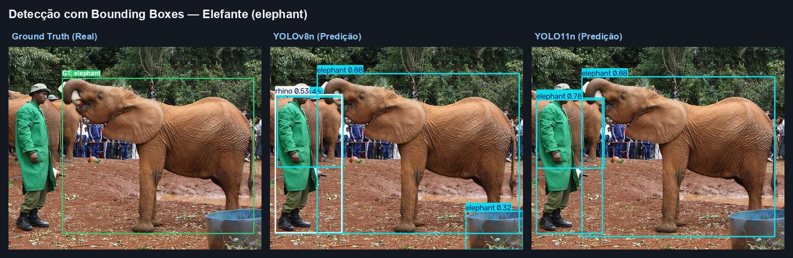
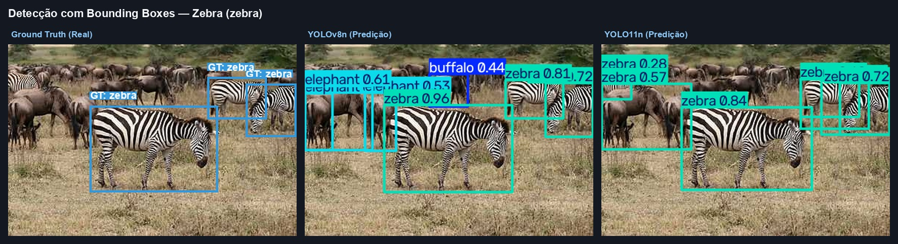
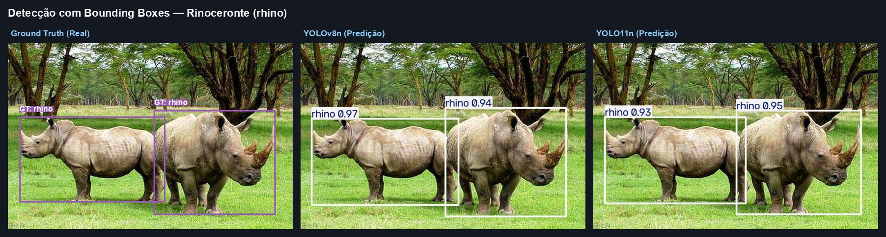
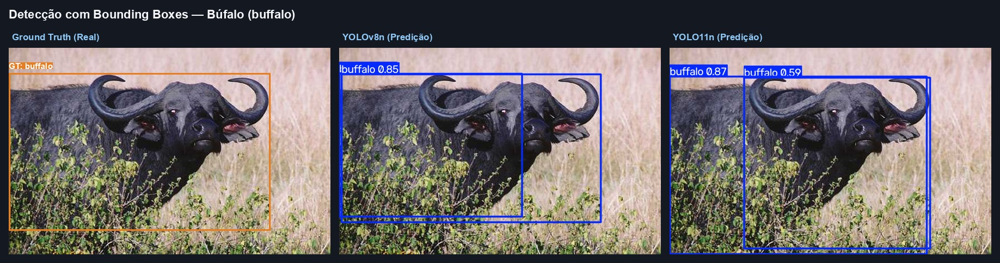

# Treino do YOLO - Animais Selvagens

Atividade treinando o YOLO em Python com a biblioteca `ultralytics` na base `african-wildlife`, que tem fotos de **búfalo, elefante, rinoceronte e zebra**.

Treinei duas versões diferentes (**YOLOv8n** e **YOLO11n**) com a mesma configuração (200 fotos de treino, 60 de validação e 15 épocas) pra ver qual saía melhor.

## Comparando YOLOv8n e YOLO11n

| Modelo | Precisão | Recall | mAP50 | Tempo por foto | Tempo de treino |
| :--- | :---: | :---: | :---: | :---: | :---: |
| YOLOv8n | 89,6% | 68,7% | 84,8% | 32,5 ms | 559,7 s |
| YOLO11n | 87,7% | 76,1% | 87,8% | 13,7 ms | 308,9 s |

No geral o **YOLO11n foi melhor**: subiu 2,99 pontos porcentuais no `mAP50` e 7,41 pontos porcentuais no `Recall`, achando mais animais que estavam no fundo das fotos. Ele também treinou quase na metade do tempo e rodou mais que o dobro mais rápido.



## Resultados com as boxes marcadas

Resultados marcando os 4 animais nas fotos de teste:




Comparação lado a lado (marcação real vs YOLOv8n vs YOLO11n):






## Como rodar

```bash
pip install -r requirements.txt
python -m src.dataset_prep
python -m src.train_and_compare
```
